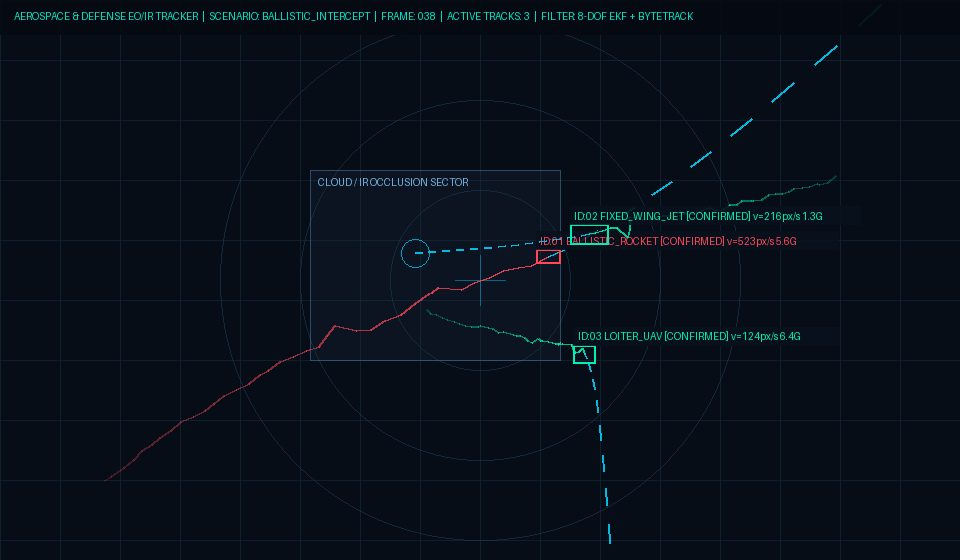

# 🛰️ Aerospace & Defense Multi-Object Target Tracker (`aerospace-target-tracker`)


**Real-time multi-object aerial target tracking, occlusion recovery, and kinematic trajectory prediction pipeline** designed for high-velocity aerospace and defense engagements (**fixed-wing aircraft, rotary/loitering UAV swarms, cruise targets, and ballistic rockets**).

Standard constant-velocity trackers fail when tracking supersonic or high-G maneuvering targets whose bounding boxes cease to overlap between consecutive frames or vanish behind cloud/thermal plume layers. `aerospace-target-tracker` combines an **8-State Constant-Acceleration Kalman Filter (CA-KF)** with **Two-Stage ByteTrack + Mahalanobis Kinematic Gating** to maintain lock and extrapolate future intercept trajectories with zero ID switches.



---

## ⚡ Key Engineering Capabilities

1. **8-DOF Constant-Acceleration State Estimation (`tracker/kalman.py`):**
   * Tracks full planar kinematics $\mathbf{x}_k = [c_x, c_y, v_x, v_y, a_x, a_y, w, h]^\top$ using a stabilized Joseph-form covariance update.
   * Accurately models boost-phase rocket acceleration and high-G evasive aircraft turns where standard constant-velocity filters lag.
   * **Lookahead Trajectory Extrapolation:** Computes $N$-step future intercept coordinates with damped acceleration decay and Circular Error Probable (CEP) uncertainty radii.

2. **Two-Stage ByteTrack + Mahalanobis Association (`tracker/bytetrack.py`):**
   * **Stage 1 (High-Confidence Lock):** Matches clear Electro-Optical / Thermal IR detections ($\text{conf} \ge \tau_{\text{high}}$) via a hybrid cost matrix blending bounding-box IoU and normalized Mahalanobis kinematic distance.
   * **Stage 2 (Occlusion & Cloud Recovery):** Recovers low-SNR targets ($\tau_{\text{low}} \le \text{conf} < \tau_{\text{high}}$) degraded by cloud cover, exhaust plumes, or long-range pixel sub-sampling.
   * **Coasting Mode:** Maintains active ballistic extrapolation during temporary complete sensor blackouts.

3. **Electro-Optical / Thermal IR Tactical Simulator & HUD (`tracker/simulator.py` & `app.py`):**
   * Pure `NumPy` + `Pillow` deterministic tactical HUD renderer (zero `libGL` system dependencies — runs headless on edge devices, CI runners, and Hugging Face Spaces).
   * Built-in engagement scenarios:
     * `ballistic_intercept`: Accelerating ballistic rocket + high-altitude fixed-wing jet + loitering UAV passing through an IR occlusion sector.
     * `high_g_evasive_fighter`: Supersonic fighter executing high-G evasive turns against a cruise target.
     * `uav_swarm_occlusion`: Multi-agent rotary UAV swarm crossing a cloud layer simultaneously with a fast ballistic track.

---

## 📐 Mathematical Formulation

The state transition matrix $\mathbf{F}$ over frame interval $\Delta t$ incorporates second-order kinematics:

$$
\mathbf{x}_{k|k-1} = \mathbf{F}\,\mathbf{x}_{k-1|k-1}, \quad
\mathbf{F} = \begin{bmatrix}
1 & 0 & \Delta t & 0 & \frac{1}{2}\Delta t^2 & 0 & 0 & 0 \\
0 & 1 & 0 & \Delta t & 0 & \frac{1}{2}\Delta t^2 & 0 & 0 \\
0 & 0 & 1 & 0 & \Delta t & 0 & 0 & 0 \\
0 & 0 & 0 & 1 & 0 & \Delta t & 0 & 0 \\
0 & 0 & 0 & 0 & \gamma & 0 & 0 & 0 \\
0 & 0 & 0 & 0 & 0 & \gamma & 0 & 0 \\
0 & 0 & 0 & 0 & 0 & 0 & 1 & 0 \\
0 & 0 & 0 & 0 & 0 & 0 & 0 & 1
\end{bmatrix}
$$

where $\gamma \in (0.90, 0.98)$ is the coasting acceleration damping factor preventing runaway divergence during prolonged sensor blackout. Association cost between track $i$ and detection $j$ combines spatial overlap and statistical innovation gating:

$$
C_{i,j} = \alpha \bigl(1 - \text{IoU}(\hat{B}_i, B_j)\bigr) + (1 - \alpha)\,\min\!\left(1, \frac{\sqrt{(\mathbf{z}_j - \mathbf{H}\hat{\mathbf{x}}_i)^\top \mathbf{S}_i^{-1} (\mathbf{z}_j - \mathbf{H}\hat{\mathbf{x}}_i)}}{d_{\max}}\right)
$$

---

## 🚀 Quickstart

```bash
git clone https://github.com/lfameS/aerospace-target-tracker.git
cd aerospace-target-tracker
pip install -r requirements.txt

# 1. Run CLI Tactical Simulation & Export HUD + Fire-Control Telemetry JSON
python cli.py --scenario ballistic_intercept --frames 38 --render assets/hud_preview.png --out telemetry.json

# 2. Launch Interactive Gradio Web HUD
python app.py

# 3. Run Unit & Occlusion Recovery Tests
pytest -v
```

---

## 🇹🇷 Türkçe Özet (Savunma Sanayii & Havacılık Nesne Takibi)

Bu depo; **İHA sürüleri, yüksek hızlı savaş uçakları, seyir hedefleri ve balistik roketlerin** elektro-optik (EO) ve termal kızılötesi (IR) sensör akışları üzerinde gerçek zamanlı tespiti, çoklu nesne takibi (**Multi-Object Tracking**) ve **yörünge/önleme noktası tahmini (Trajectory & Intercept Prediction)** için geliştirilmiş açık kaynaklı bir referans mimaridir.

* **8-Durumlu Sabit İvmeli Kalman Filtresi (`ConstantAccelerationKalmanFilter`):** Yüksek hız ve ani G manevralarında klasik sabit hızlı filtrelerin yaşadığı gecikmeyi ortadan kaldırır; bulut veya sis arkasında kalan (`COASTING`) hedeflerin gelecekteki 25–45 karelik yörüngesini fizik tabanlı olarak kestirir.
* **İki Aşamalı ByteTrack + Mahalanobis Kapılama (`ByteTracker`):** Düşük güven skorlu (bulut arkası / uzak mesafe küçük piksel izi) tespitleri ikinci aşamada kinematik uzaklık matrisiyle eşleştirerek **ID kaybını (ID-switch) sıfıra indirir**.

---

## 📄 License

MIT © [İzzet Koyak](https://github.com/lfameS) · [LACUNATE](https://lacunate.com)
